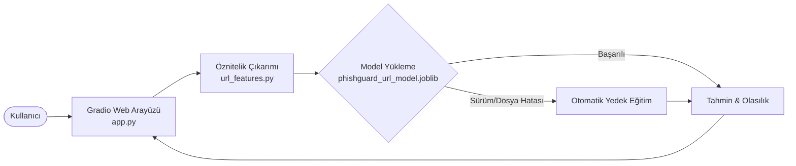

<div align="center">

# 🛡️ PhishGuard AI

**URL oltalama (phishing) tespiti, yapısal öznitelik analizi ve dayanıklı dağıtım.**

Python · scikit-learn (`HistGradientBoosting`) · Gradio · Hugging Face Spaces

[](https://huggingface.co/spaces/alminanur/phishguard-ai)
[](https://www.python.org/)
[](https://scikit-learn.org/)
[](https://www.gradio.app/)

</div>

---

## Bu proje neden var?

Oltalama (*phishing*) saldırılarında URL'ler çoğu zaman meşru alan adlarını taklit etmek için uzun alt alan adları, tireler, sayısal diziler, şüpheli parametreler, IP adresleri veya HTTP/HTTPS farkları gibi yapısal izler taşır. Ancak dağıtım ortamlarında yalnızca model dosyasını kaydetmek her zaman yeterli değildir; ortamlar arası `scikit-learn` sürüm uyuşmazlıkları veya donanım/runtime farkları servisin açılışta kırılmasına yol açabilir.

**PhishGuard AI**, girilen URL'lerden sayısal öznitelikler çıkaran, `Phishing (0)` ve `Legitimate (1)` sınıfları için olasılık tabanlı tahmin üreten ve sürüm uyuşmazlıklarına karşı yedek eğitim mekanizmasıyla ayakta kalan modüler bir URL analiz uygulamasıdır.

## ✨ Öne Çıkan Özellikler

| | |
|---|---|
| 🔍 **Öznitelik Çıkarımı** | URL, alan adı (*hostname*), yol (*path*) ve sorgu (*query*) uzunlukları ile yapısal karakter sayımları (`url_features.py`) |
| 🎯 **Sınıflandırma** | `HistGradientBoostingClassifier` ile `Phishing (0)` / `Legitimate (1)` tahmini ve sınıf olasılıkları |
| 🛡️ **Sürüm Dayanıklılığı** | `joblib` yükleme/serileştirme (`_loss` vb. sürüm farkı) hatalarında otomatik yedek eğitim akışı (`app.py`) |
| 📊 **Şeffaf İnceleme** | Her URL için çıkarılan tüm özellik değerlerini arayüzde tablo halinde görüntüleme |
| 🌐 **Canlı Arayüz** | Hazır örnek URL'lerle tek tıkla test edilebilen Gradio arayüzü (`Hugging Face Spaces`) |
| 📦 **Hafif Dağıtım** | Minimal bağımlılıklarla (`requirements.txt`) hızlı kurulum ve bulutta çalıştırma |

## 🚀 Hızlı Başlangıç

**Gereksinimler:** Git ve Python 3.10+.

```bash
# 1. Depoyu klonla
git clone [https://github.com/almina-nur/PhishGuard-AI.git](https://github.com/almina-nur/PhishGuard-AI.git)
cd PhishGuard-AI

# 2. Bağımlılıkları kur
pip install -r requirements.txt

# 3. Uygulamayı başlat
python app.py

```

Canlı arayüz ayrıca doğrudan Hugging Face Spaces üzerinden kullanılabilir:

* **Canlı Demo:** [https://huggingface.co/spaces/alminanur/phishguard-ai](https://www.google.com/url?sa=E&source=gmail&q=https://huggingface.co/spaces/alminanur/phishguard-ai)

## 📊 Değerlendirme ve Mühendislik Notları

> ⚠️ **Önemli not.** Mevcut sürüm, sözdizimsel/yapısal URL özelliklerinin uçtan uca akışını ve canlı arayüz kararlılığını doğrulamaya odaklanır. Gerçek dünyadaki farklı oltalama kampanyalarına karşı nihai genelleme başarımı için geniş kapsamlı, dengeli ve dış kaynaklı etiketli veri setleriyle değerlendirme gereklidir.

### Ne öğrendik ve nelerin doğrulanması gerekiyor?

1. **Sürüm uyumsuzlukları dağıtımı kırabilir.** Farklı `scikit-learn` sürümleri arasında serileştirilmiş ağaç/boosting modelleri yüklenirken iç modül uyumsuzlukları (`ModuleNotFoundError` vb.) ortaya çıkabiliyor. `app.py` içine eklenen güvenli yükleme + yedek eğitim (`fallback`) akışı sayesinde arayüzün çökmeden açılması sağlandı.
2. **Sözdizimsel özellikler tek başına tüm saldırıları kapsamaz.** URL uzunluğu, tire/rakam/nokta sayıları, HTTPS ve IP kullanımı güçlü başlangıç sinyalleri verir; ancak IDN/homograf saldırıları, yeni kaydedilmiş alan adları veya sayfa içeriği/DNS sinyalleri olmadan bazı gelişmiş oltalama URL'leri gözden kaçabilir.
3. **Gerçek dünya veri setiyle doğrulama şart.** Küçük veya sentetik örneklerle elde edilen yüksek skorlar gerçek trafikteki çeşitliliği temsil etmez; `Precision`, `Recall`, `F1-Score` ve `ROC-AUC` metriklerinin geniş ve bağımsız bir test setinde ölçülmesi gerekir.

## 🏗️ Mimari



### Depo yapısı

```text
PhishGuard-AI/
├── app.py                        # Gradio arayüzü, tahmin akışı ve fallback mekanizması
├── url_features.py               # URL yapısal ve sözdizimsel öznitelik çıkarımı
├── phishguard_url_model.joblib   # Kaydedilmiş model paketi ve öznitelik listesi
├── requirements.txt              # Python bağımlılıkları
└── README.md                     # Proje dokümantasyonu

```

## ⚠️ Bilinen Sınırlamalar

* Yalnızca URL metninden çıkarılan yapısal/sözdizimsel özellikler kullanılır; sayfa içeriği, WHOIS/DNS geçmişi veya sertifika analizi yapılmaz.
* Geniş, çok kaynaklı gerçek oltalama veri setleriyle kapsamlı benchmark raporları henüz eklenmemiştir.
* Güvenlik uyarısı: Bu uygulama analiz ve karar destek amaçlıdır; kurumsal ağ, tarayıcı veya e-posta güvenlik sistemlerinin tek başına yerine geçmez.

## 🗺️ Yol Haritası

**Tamamlananlar**

* [x] `url_features.py` öznitelik çıkarım modülünün oluşturulması
* [x] `HistGradientBoostingClassifier` sınıflandırma ve olasılık çıktısı akışı
* [x] `scikit-learn` sürüm uyumsuzluklarına karşı otomatik yedek (`fallback`) mekanizması
* [x] Gradio arayüzünün Hugging Face Spaces üzerinde yayına alınması

**Sıradaki Adımlar**

* [ ] Geniş ve dengeli açık oltalama/meşru URL veri setleriyle yeniden eğitim ve `F1 / ROC-AUC` raporlaması
* [ ] Alan adı entropisi, TLD/alt alan adı derinliği ve kısaltılmış URL sinyalleriyle öznitelik setinin genişletilmesi
* [ ] Eşik (*threshold*) optimizasyonu ve false-positive / false-negative hata analizi
* [ ] Otomatik testler (`pytest`) ve CI iş akışının eklenmesi

## 🤝 Katkı Sağlama

Öneriler, hata bildirimleri ve pull request'ler memnuniyetle karşılanır. Büyük değişiklikler için önce bir *issue* açarak kapsamı paylaşabilirsin.

## 📄 Lisans

Bu proje [MIT Lisansı](https://www.google.com/search?q=LICENSE) altında sunulmaktadır.

```

